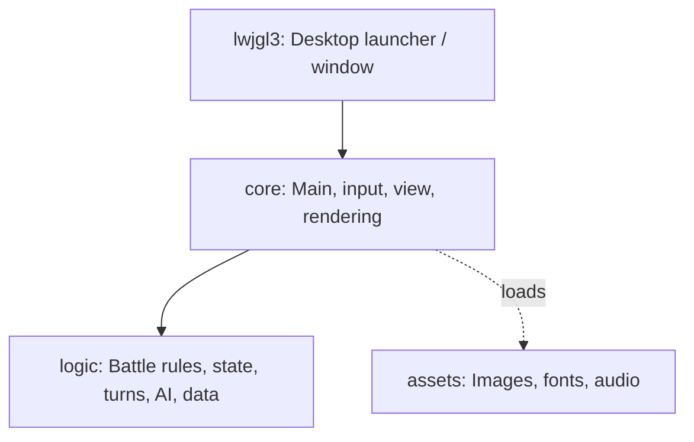
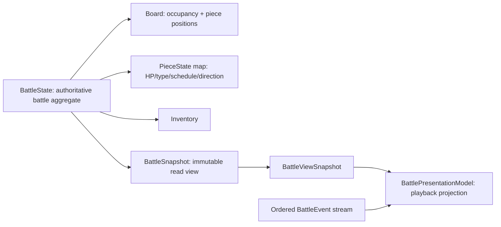
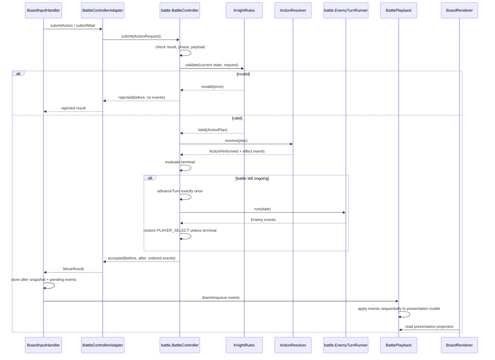
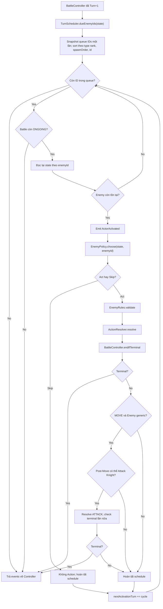

# RogueKnight — Codebase Overview

> Phạm vi: khảo sát source trên branch refactor/architecture-cleanup-7119.
> Đây là bản inventory rút gọn phục vụ onboarding/audit, không phải UML đầy đủ hoặc xác nhận mọi requirement đã đạt.

## 1. Baseline và cấu trúc module

- Java Temurin 21, libGDX 1.13.1, LWJGL3, Gradle Wrapper 9.8.0, JUnit Jupiter 5.10.0, Gson 2.13.2.
- Gradle modules: logic, core, lwjgl3.
- Dependency direction: lwjgl3 → core → logic.

| Module | Trách nhiệm | Boundary cần giữ |
| --- | --- | --- |
| logic | Domain state, Board, rules/validation, Action resolution, turn lifecycle, Enemy AI/policies, data | Pure Java; không import libGDX; không biết pixel/input/render |
| core | Desktop game flow, input adapter, snapshots/events, presentation playback, renderer | Gửi request và hiển thị kết quả từ logic; không tự định nghĩa luật |
| lwjgl3 | Desktop launcher và backend/window configuration | Chỉ khởi chạy core |
| assets | Tài nguyên hình ảnh/font/âm thanh | Không chứa gameplay rules |

## 2. Class inventory rút gọn

### logic

| Package / class | Vai trò |
| --- | --- |
| board/Board, board/Position | Board sở hữu occupancy và map pieceId → Position; Rock bất biến; không sở hữu HP/type/turn |
| battle/BattleState | Aggregate mutable của một trận; sở hữu Board, PieceState, Inventory, globalTurn, phase, result |
| battle/PieceState, PieceType, Inventory, EquipmentState | Runtime state của quân và trang bị |
| battle/BattleSnapshot, StateView | Snapshot/read-only view cho caller; StateView phục vụ rules/AI |
| battle/BattleController | Public entry point cho Player Action; sở hữu lifecycle và ủy quyền mutation cho rules/resolver nội bộ |
| battle/KnightRules, EnemyRules | Sinh target/validate theo luật tương ứng; không tự áp dụng state mutation |
| battle/ActionResolver, ActionPlan | Áp dụng plan đã validate lên state và phát ordered events; resolver không tự validate/tăng turn/chạy queue |
| battle/EnemyTurnRunner, TurnScheduler | Chụp queue Enemy đến hạn, điều phối activation và lịch kế tiếp |
| action/BattleEvent, ActionRequest, ActionResult, EnemyDecision, EnemyPolicy | Contract request/result/event/decision giữa domain components |
| ai/EnemyAI, PawnPolicy, GenericEnemyPolicy | Chọn policy theo loại Enemy; chỉ quyết định, không sở hữu state |

### core

| Package / class | Vai trò |
| --- | --- |
| Main | Khởi tạo trận desktop, poll input, điều phối playback và render frame |
| input/BoardInputHandler | Chuyển click/key selection thành action call; giữ feedback/snapshot UI và pending events |
| input/BattleControllerAdapter | Chuyển đổi giữa API domain và UI-facing API; ánh xạ tọa độ, snapshot và event |
| input/MoveResult, BattleControllerPort, ActionMode | Contract input-facing |
| view/BattleViewSnapshot, PresentationPiece | Snapshot hiển thị và dữ liệu quân có stable ID |
| view/BattlePresentationModel | Projection mutable dành riêng cho playback; không phải nguồn gameplay truth |
| view/BattleEventQueue, BattlePlayback | FIFO event queue và tiêu thụ event theo delta-time |
| view/BoardProjection, BoardPosition, BoardRenderer | Chuyển world/board coordinates và render bàn cờ/presentation |

## 3. Ownership và state authority

- BattleState là nguồn state có thẩm quyền của gameplay.
- Board là nguồn vị trí/occupancy duy nhất; PieceState không giữ vị trí mutable.
- BattleController điều phối lifecycle; ActionResolver chỉ áp dụng action đã validate.
- BattlePresentationModel là bản chiếu hiển thị được khởi tạo từ snapshot rồi replay events. Không dùng nó để validate hoặc quyết định luật.

## 4. Trace: Knight Player Action

Key observations:

1. Invalid request returns rejected result before Resolver; it must not mutate gameplay state or emit events.
2. A valid Player Action begins with ActionPerformed; resolver emits effect events.
3. If the Player Action itself ends the battle, no Turn+1 and no Enemy phase.
4. Otherwise Controller increments globalTurn once, emits TurnAdvanced, then runs Enemy phase.
5. UI receives immutable before/after snapshots plus the ordered event list; playback is presentation-only.

## 5. Trace: Enemy phase

Rules observed in implementation:

- Queue được chụp một lần đầu Enemy phase; Queen mới được tạo do promotion không chen vào queue đang chạy.
- Queue order: PAWN → ROOK → BISHOP → KING → QUEEN, sau đó spawnOrder, rồi id.
- Trước mỗi activation, runner đọc lại state theo ID; Enemy đã bị loại bởi action trước thì bị skip.
- ActorActivated được phát trước policy decision, kể cả activation sau đó Skip.
- Skip không phát ActionPerformed, nhưng lịch activation vẫn được đẩy thêm một cycle.
- Generic Enemy (Rook/Bishop/King/Queen tại thời điểm bắt đầu activation) có thể Move rồi tự Attack dựa trên post-Move state; check terminal sau từng Action.
- Pawn vừa promote thành Queen không được thực hiện follow-up Attack trong activation đó.
- Enemy phase không tự tăng globalTurn.
- AI chọn request invalid được xem là lỗi tích hợp và ném IllegalStateException, không âm thầm Skip.

## 6. Event playback hiện tại

- BattleEvent là event stream có thứ tự: Action/effect, TurnAdvanced, ActorActivated, Enemy effects, BattleEnded.
- BoardInputHandler lưu event từ accepted MoveResult; drainEvents() trả danh sách immutable rồi clear buffer.
- BattlePlayback tiêu thụ FIFO theo khoảng thời gian/event; BattlePresentationModel áp dụng event để cập nhật quân theo stable ID.
- Main tạm khóa thao tác gameplay mới khi queue playback còn event.
- BoardRenderer render quân từ presentation projection, không suy ra identity từ tên hoặc vị trí.
- Hiện playback là step/timed state playback, chưa phải animation tween liên tục (lerp quân giữa hai ô, hit flash, shake, fade-out).

## 7. Baseline kiểm thử và giới hạn khảo sát

- Người dùng xác nhận trên local: baseline build --rerun-tasks exit code 0 tại commit c79978c.
- Người dùng xác nhận: BattlePresentationModelTest + BattleEventQueueTest và full build exit code 0 tại 6cd1a1d.
- Người dùng xác nhận: BattlePlaybackTest + hai suite trên và full build exit code 0 tại 4a9a923.
- Commit dọn unused import sau đó chưa được xác nhận build lại tại thời điểm ghi tài liệu.
- Tài liệu này trace source và contract; không thay thế manual desktop playtest hoặc requirement audit BR1–BR4.

## 8. Những điểm cần tiếp tục xác minh

1. Chạy desktop và quan sát playback thực tế: timing, input lock, nhiều Enemy, Skip, Knight defeat.
2. So khớp toàn bộ requirement BR1–BR4 với implementation/test; đặc biệt invalid-state immutability, scheduler/promotion, terminal stop, equipment edge cases.
3. Kiểm tra BoardInputHandler.currentSnapshot là snapshot cuối action trong khi presentation model đang replay trạng thái trung gian; renderer hiện chỉ dùng snapshot cho rocks/fixture/fallback data và ẩn legal highlights trong playback.
4. Kiểm tra UI lifecycle đầy đủ theo phạm vi GDD: Main Menu → Map Preview → Equipment Selection → Battle → Result/Restart; đây không nằm trong phạm vi trace hai luồng gameplay ở tài liệu này.
5. Kiểm tra CI/PR review và cập nhật trạng thái task theo nguồn quản lý chính thức của nhóm.
